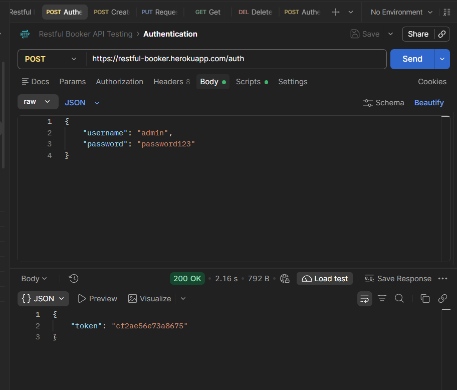
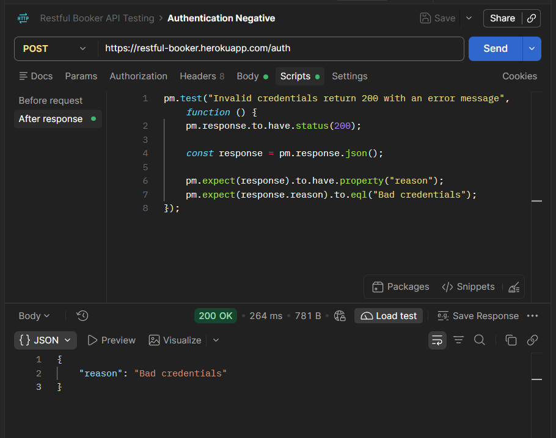
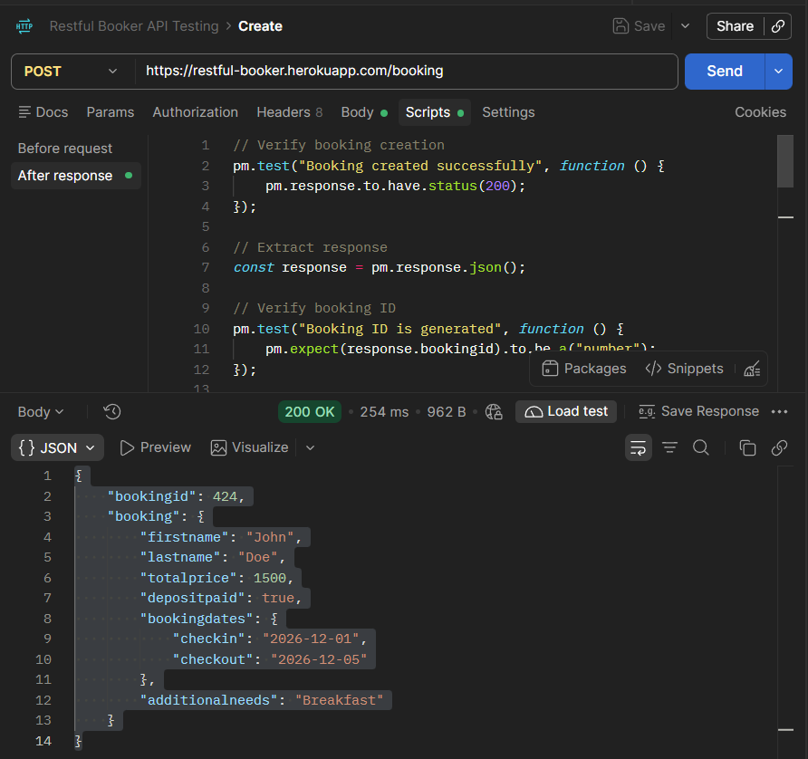
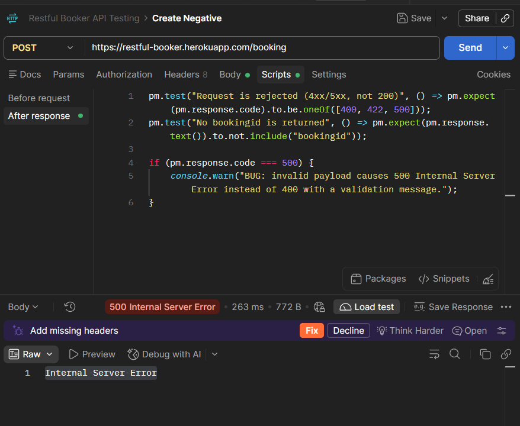
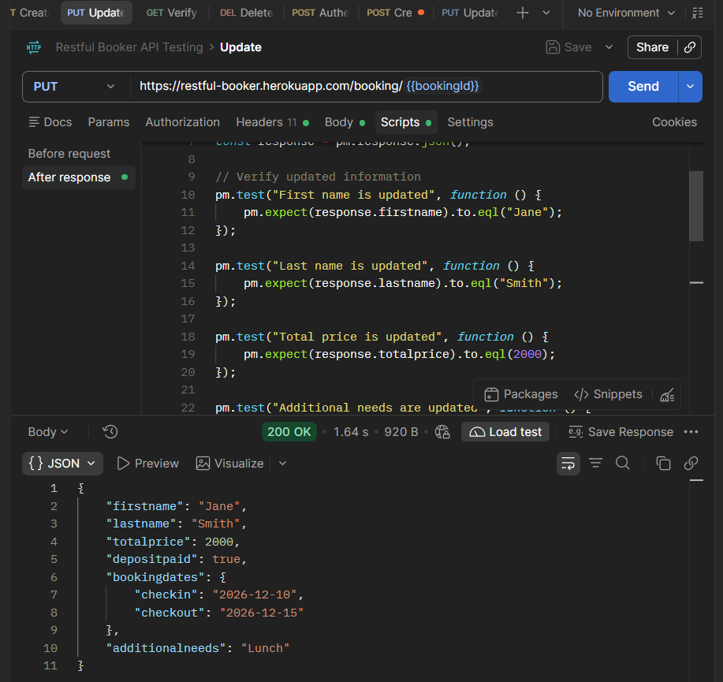
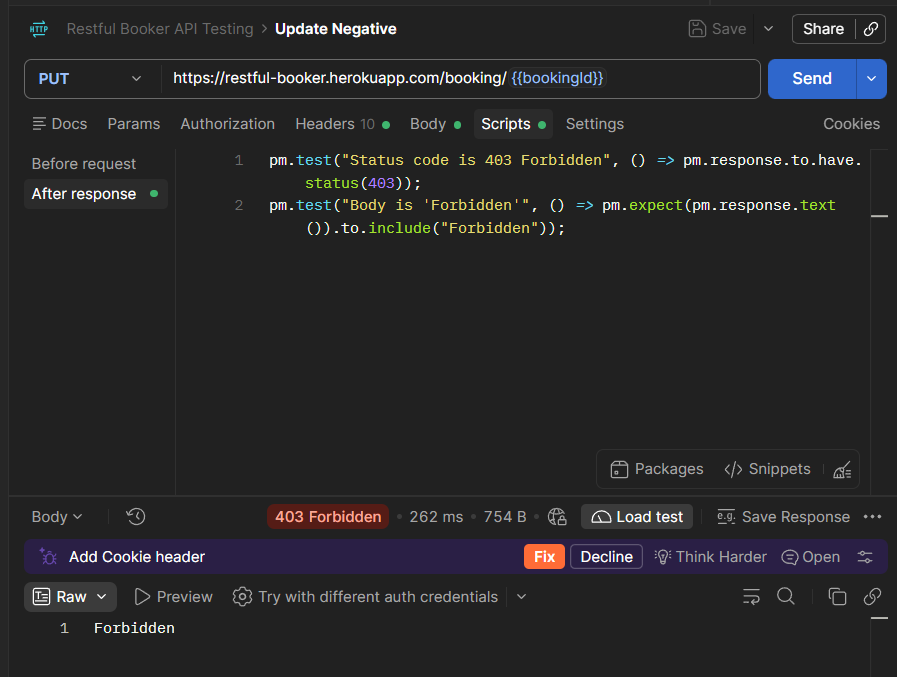
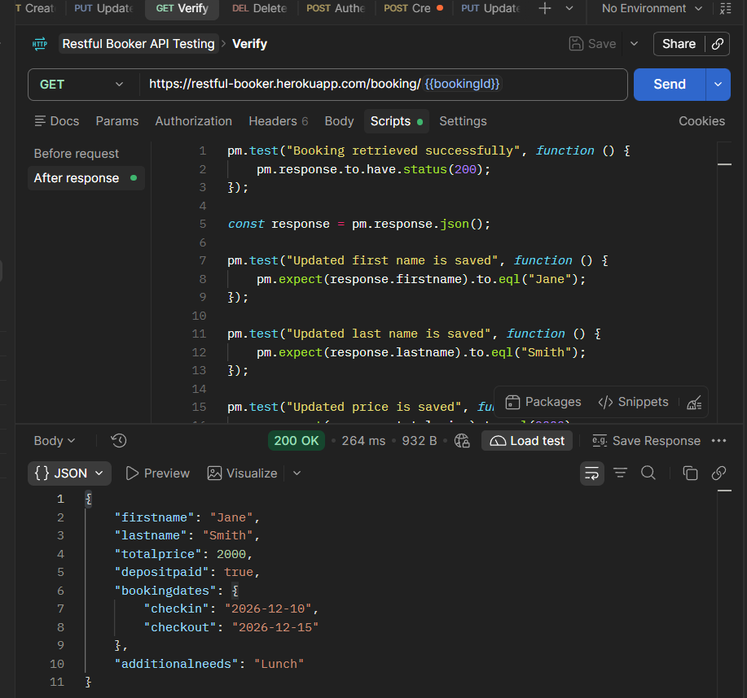
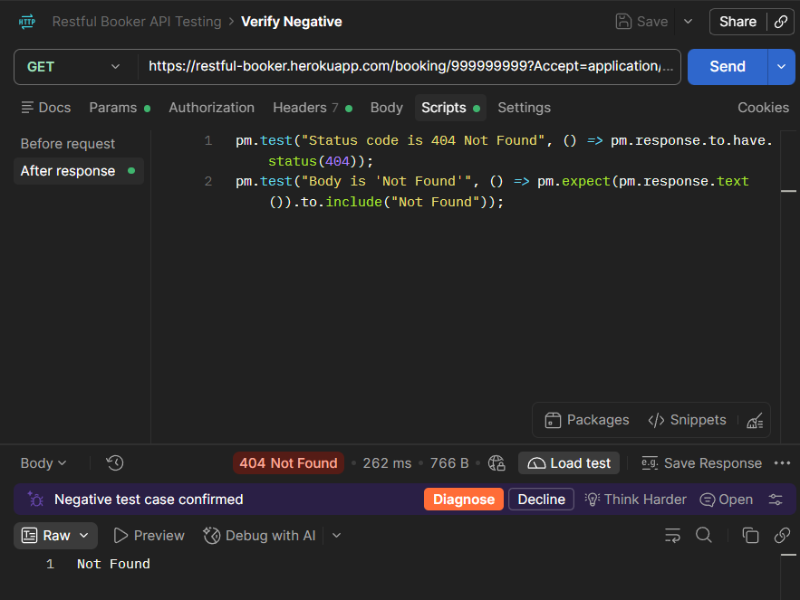
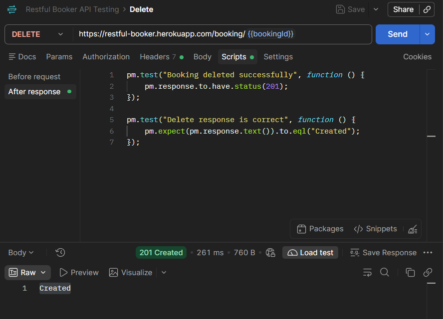
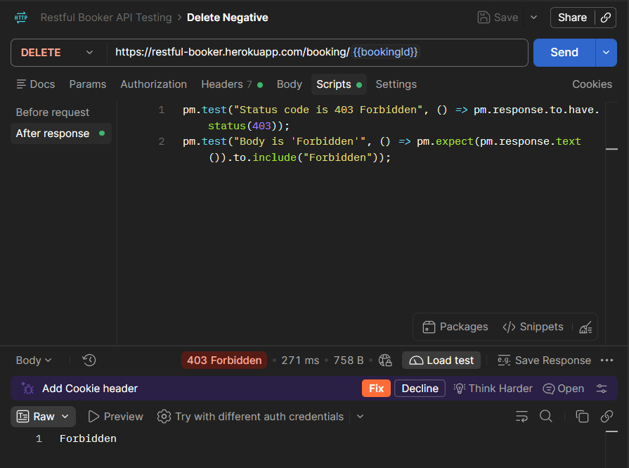

# Restful-booker-api-testing

Automated API test suite for the live [Restful-Booker](https://restful-booker.herokuapp.com/apidoc/index.html) API.
Executes a chained flow: **Auth → Create → Update → Verify → Delete**, with a negative scenario for every endpoint.

## How to run
1. Import `Restful Booker API Testing.postman_collection.json` into Postman.
2. Right-click the collection → **Run collection** → **Run** (requests execute in order).
3. No setup needed: `token` and `bookingId` are captured automatically as collection variables.

## Dynamic variable chaining
| Variable | Set by | Used by |
|---|---|---|
| `token` | Auth (POST /auth) | PUT and DELETE via `Cookie: token={{token}}` |
| `bookingId` | Create (POST /booking) | PUT, GET, DELETE via `/booking/{{bookingId}}` |

## Test coverage
| Endpoint | Positive test | Negative test |
|---|---|---|
| POST /auth | 200, token schema, token saved | Wrong password → no token issued |
| POST /booking | 200, JSON schema, payload echo, `bookingid` saved | Missing required fields → rejected |
| PUT /booking/:id | 200, schema, every updated field asserted | No token → 403 Forbidden |
| GET /booking/:id | 200, schema, update persisted, unchanged fields kept | Non-existent ID → 404 |
| DELETE /booking/:id | 201, body "Created", then GET returns 404 | No token → 403; already deleted → 405 |

## Bugs / API deviations found
| # | Endpoint | Actual behavior | Expected behavior | Severity |
|---|---|---|---|---|
| 1 | POST /auth | Invalid credentials return **200** with `{"reason":"Bad credentials"}` | **401 Unauthorized** | Medium |
| 2 | POST /booking | Missing required fields return **500 Internal Server Error** | **400 Bad Request** with validation message | High |
| 3 | DELETE /booking/:id | Successful delete returns **201 Created** | **200 OK** or **204 No Content** | Low |
| 4 | DELETE /booking/:id | Deleting a non-existent booking returns **405 Method Not Allowed** | **404 Not Found** | Low |

## Request / response analysis
## Request / response analysis

| Endpoint | Positive | Negative |
|---|---|---|
| POST /auth |  |  |
| POST /booking |  |  |
| PUT /booking/:id |  |  |
| GET /booking/:id |  |  |
| DELETE /booking/:id |  |  |

### 1. POST /auth
- **Request:** `POST /auth` with body `{"username": "admin", "password": "password123"}`
- **Response:** `200 OK`, body `{"token": "<string>"}`
- **Analysis:** The API issues a token that is saved to `{{token}}` and reused by the update and delete requests. The response matches the JSON schema.
- **Negative scenario:** Wrong password. Response is `200 OK` with `{"reason": "Bad credentials"}` and no token. This is a bug, because a failed login should return `401 Unauthorized`.

### 2. POST /booking
- **Request:** `POST /booking` with a full booking body (firstname, lastname, totalprice, depositpaid, bookingdates, additionalneeds)
- **Response:** `200 OK`, body contains `bookingid` and a `booking` object
- **Analysis:** The returned booking matches the payload sent and the JSON schema. `bookingid` is saved to `{{bookingId}}` for the rest of the flow.
- **Negative scenario:** Body with only `firstname`. Response is `500 Internal Server Error`. This is a bug, because bad client input should return `400 Bad Request` with a validation message.

### 3. PUT /booking/:id
- **Request:** `PUT /booking/{{bookingId}}` with header `Cookie: token={{token}}` and a full updated body
- **Response:** `200 OK`, body shows the updated values
- **Analysis:** All updated fields are returned correctly. The extracted ID and token are chained from the earlier requests.
- **Negative scenario:** Same request without the token. Response is `403 Forbidden`. This is correct behavior, because the API blocks unauthorized updates.

### 4. GET /booking/:id
- **Request:** `GET /booking/{{bookingId}}`
- **Response:** `200 OK`, body contains the booking
- **Analysis:** The assertions confirm the update persisted (the new values are returned) and the response matches the schema.
- **Negative scenario:** `GET /booking/999999999`. Response is `404 Not Found`. This is correct behavior for a missing resource.

### 5. DELETE /booking/:id
- **Request:** `DELETE /booking/{{bookingId}}` with header `Cookie: token={{token}}`
- **Response:** `201 Created`, body `Created`
- **Analysis:** The booking is deleted and a follow-up GET returns `404`, which confirms the cleanup. Status `201` is a minor bug, because `200` or `204` is expected for a delete.
- **Negative scenario:** Delete without a token. Response is `403 Forbidden`. This is correct behavior, because the API blocks unauthorized deletes.

## Results
Add the Collection Runner summary screenshot here, for example ``.
